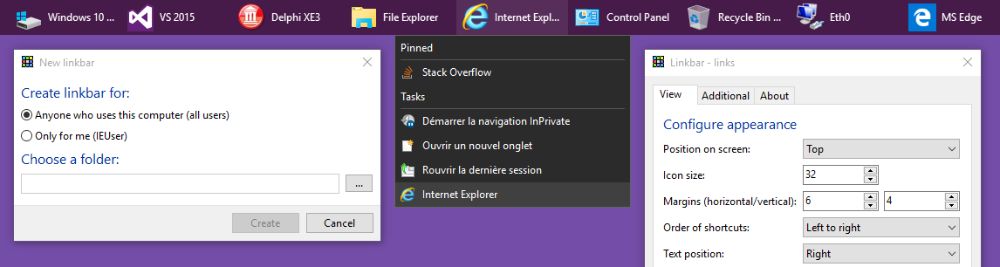
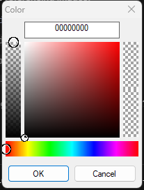
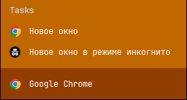

[Русский](README.md) | **English**

# Linkbar

Linkbar is a free desktop toolbar for Windows. This is a complete C++20 port of
the original Delphi application: WinAPI, GDI and the system GDI+ only, with no
third-party rendering libraries.



## What is Linkbar?

The panel docks to any screen edge and shows shortcuts from a selected folder —
like an extra taskbar. `.lnk`, `.url` and `.website` files are supported, along
with multiple panels, per-panel settings and multi-monitor setups.

## Features

- Docking to the left, top, right or bottom edge of the screen.
- Multiple independent panels (each one is a separate process).
- Icon size, margins, item order, alignment and text position settings.
- Light, dark and accent themes; transparency, glass and AeroGlass.
- Auto-hide on hover, left-click or right-click, with a configurable delay.
- Global hotkey to reveal a hidden panel.
- Drag & drop, sorting, separators, rename and delete.
- Explorer context menu and Jump Lists with tasks, pinned and recent items.
- Settings live in a regular `.lbr` profile; the format is compatible with the
  Delphi version.
- Localization from `Locales\*.ini`.

## Build

Requires MSVC with C++20 support, the Windows SDK and CMake.

```powershell
cd cpp
cmake -S . -B build -G "Visual Studio 18 2026" -A x64
cmake --build build --config Release
```

Output: `cpp/build/Release/linkbar.exe`.

The build is clean with `/W4`: **0 warnings, 0 errors**.

## Usage

```text
linkbar.exe                  open every discovered panel
linkbar.exe -f <file.lbr>    open the specified profile
linkbar.exe -n              create a new panel
linkbar.exe -ca             close all panels
linkbar.exe -l <locale>     UI language (for example, en-US)
linkbar.exe -d <ms>         startup delay in milliseconds
```

## Settings

Open **Settings…** from the panel context menu. The dialog exposes every option
of the original: position, icons, margins, text, colors, transparency, auto-hide,
hotkey, separators and Jump Lists.

| Color picker | Jump List |
|---|---|
|  |  |

## Layout

The C++ sources live in [`cpp/`](cpp/); see [`cpp/README.md`](cpp/README.md) for
the technical overview. The original Delphi sources, components and resources
are kept unchanged.

## License

[MIT](LICENSE). Original project: [Asaq / Linkbar](https://github.com/ATGH15102AFMLD/Linkbar).
