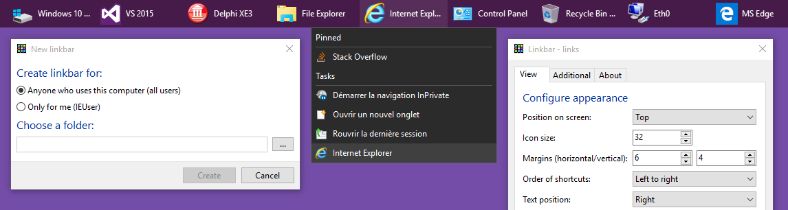
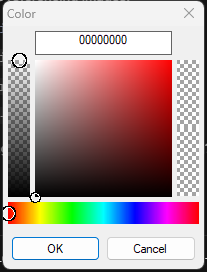
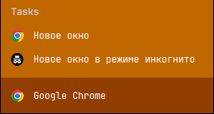

**Русский** | [English](README.en.md)

# Linkbar

Linkbar — бесплатная панель быстрого доступа для рабочего стола Windows. Это
полный перенос оригинального Delphi-приложения на C++20: только WinAPI, GDI и
системный GDI+, без сторонних библиотек отрисовки.



## Что такое Linkbar?

Панель закрепляется у любого края экрана и показывает ярлыки из выбранной папки —
как дополнительный taskbar. Поддерживаются `.lnk`, `.url` и `.website`, несколько
панелей одновременно, отдельные настройки для каждой панели и работа на нескольких
мониторах.

## Возможности

- Закрепление у левого, верхнего, правого или нижнего края экрана.
- Несколько независимых панелей (каждая — отдельный процесс).
- Настройка размера иконок, отступов, порядка, выравнивания и положения текста.
- Светлая, тёмная и акцентная темы; прозрачность, стекло и AeroGlass.
- Автоскрытие: по наведению, левому или правому клику; задержка показа.
- Глобальная горячая клавиша для показа скрытой панели.
- Перетаскивание ярлыков, сортировка, разделители, переименование и удаление.
- Контекстное меню проводника и Jump List с задачами, закреплёнными и недавними
  элементами.
- Настройки хранятся в обычном `.lbr`-профиле; формат совместим с Delphi-версией.
- Локализация из `Locales\*.ini`.

## Сборка

Требуются MSVC с поддержкой C++20, Windows SDK и CMake.

```powershell
cd cpp
cmake -S . -B build -G "Visual Studio 18 2026" -A x64
cmake --build build --config Release
```

Готовый файл: `cpp/build/Release/linkbar.exe`.

Сборка проверена с `/W4`: **0 предупреждений, 0 ошибок**.

## Запуск

```text
linkbar.exe                  открыть все найденные панели
linkbar.exe -f <file.lbr>    открыть указанный профиль
linkbar.exe -n              создать новую панель
linkbar.exe -ca             закрыть все панели
linkbar.exe -l <locale>     язык интерфейса (например, ru-RU)
linkbar.exe -d <ms>         задержка запуска в миллисекундах
```

## Настройки

Параметры открываются из контекстного меню панели: **Settings…**. Диалог содержит
все параметры оригинала — положение, иконки, отступы, текст, цвета, прозрачность,
автоскрытие, горячую клавишу, разделители и Jump List.

| Выбор цвета | Jump List |
|---|---|
|  |  |

## Структура

Исходный код C++-версии находится в [`cpp/`](cpp/), подробное техническое описание —
в [`cpp/README.md`](cpp/README.md). Оригинальные Delphi-исходники, компоненты и
ресурсы сохранены без изменений.

## Лицензия

[MIT](LICENSE). Оригинальный проект: [Asaq / Linkbar](https://github.com/ATGH15102AFMLD/Linkbar).
